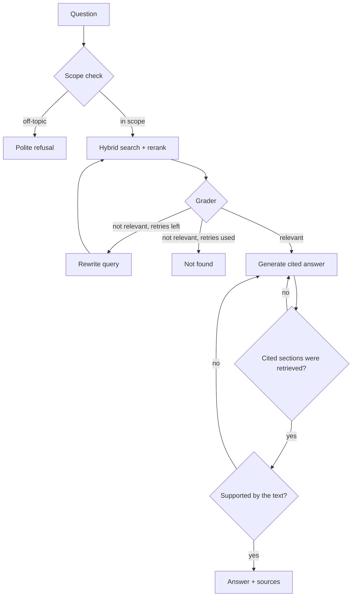
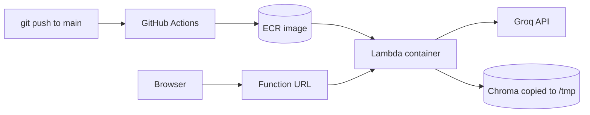

# ClauseCite

A question-answering assistant for India's **Digital Personal Data Protection Act, 2023**. Ask in plain words and get an answer that cites the sections it came from, with the clause text shown beside it. If the Act doesn't cover the question, it says so instead of guessing.

**Live demo:** `<paste your Lambda Function URL here>` (the first request after a quiet period is slow while the models load)

> Informational only, not legal advice. The corpus is the text of the Act as on 19 November 2025 (India Code consolidated copy). The DPDP Rules are not included.

## What it does

- Answers questions about the Act and cites sections like `[Section 9]` or `[Schedule]`.
- Refuses off-topic questions, and answers "Not found in the Act" when the Act is silent.
- Checks its own work: every cited section must have been retrieved, and the answer must be supported by the retrieved text.
- Front end with clause excerpts next to each answer, a section finder, select-text-to-ask, follow-up buttons, and a history sidebar saved in the browser.

## How it works



If a check still fails after two generation attempts, the answer is "Not found in the Act".

**Offline (built once)**
1. `parse.py` splits the India Code PDF into 44 sections plus the Schedule, with section number, title, chapter and page (PyMuPDF and regular expressions).
2. `index.py` cuts sections into chunks of about 1,000 characters at sub-section boundaries, adds a short header to each, embeds them with `BAAI/bge-small-en-v1.5`, and stores 89 chunks in Chroma.

**Online (every question), in `graph.py` (LangGraph)**
- **Scope check:** distance from the question to the nearest chunk. Below 0.85 is in scope, 1.1 or above is refused, and the zone in between is decided by the LLM. Cutoffs were chosen from measured distances.
- **Retrieval:** vector search and BM25 merged with reciprocal rank fusion, then reranked with `cross-encoder/ms-marco-MiniLM-L-6-v2`, with at most two chunks per section.
- **Grader:** the LLM judges whether the retrieved text can answer the question. If not, the query is rewritten (up to two times, never repeating a previous query) and the new results are added to the old ones.
- **Generate, verify, faithfulness:** the answer must cite sections in square brackets. Code checks that every cited section was retrieved, then the LLM checks that the claims are supported.
- **LLM:** Groq `openai/gpt-oss-120b` on the free tier. `llm.py` can switch to a local Ollama model with one setting.

## Evaluation

Retrieval alone (no LLM calls), on the 22 answerable questions of the gold set, top 4 results:

| Mode | At least one correct section | All needed sections |
|---|---|---|
| Vector (baseline) | 22/22 | 20/22 |
| Vector + BM25 | 22/22 | 20/22 |
| Vector + BM25 + reranker | 22/22 | 21/22 |

Full pipeline with Groq `gpt-oss-120b`. An answerable question passes if it is not refused, is not "Not found", and cites at least one expected section. Unanswerable questions must end in "Not found" or a refusal, and off-topic questions in a refusal.

| Question set | Questions | Result | Notes |
|---|---|---|---|
| `gold.jsonl` | 28 | 28/28 | I tuned the pipeline against this set, so treat it as optimistic |
| `heldout.jsonl` | 13 | 9/13, then 13/13 | Fixes were made after its failures, so it is no longer a fair test |
| `heldout2.jsonl` | 13 | **12/13** | Written afterwards and never tuned on. This is the honest figure |

The one miss: "Can a hospital use my data without consent in a medical emergency?" ended as "Not found". Section 7(f) covers it, but its clause sits in a chunk that also holds several other uses, so the chunk ranked poorly.

**Model comparison** (same 10-question subset and code version at the time):

| Model | Result | Time |
|---|---|---|
| Local `llama3.2` (3B) via Ollama | 3/10 | 12.9 min |
| `gpt-oss-120b` via Groq | 7/10 (before later fixes) | 3.2 min |

With the original LLM-based scope check, the local `llama3.2:1b` answered OUT to every question, which is why the scope check became a distance rule. The 3B model was too weak for the grader and the faithfulness check.

Reproduce (Windows):

```
python src\eval_retrieval.py
set LLM_PROVIDER=groq&& set GOLD=eval/heldout2.jsonl&& python src\eval_graph.py 1
```

## Deployment



- **Docker image** on the AWS Lambda Python 3.12 base, with CPU-only PyTorch, both search models downloaded at build time (runs offline), and the web page and Chroma database copied in.
- **`lambda_handler.py`** copies the database to `/tmp` (Lambda's only writable folder) and wraps the FastAPI app with Mangum.
- **Lambda:** x86_64 container, 3008 MB memory, 2 minute timeout, a public Function URL, and reserved concurrency of 2 so nobody can run up the Groq quota. The Groq key is an environment variable and is never in the image.
- **Region:** `ap-south-1` (Mumbai).
- **CI/CD:** `.github/workflows/deploy.yml` builds the image, pushes it to ECR and updates the function on every push to `main`. AWS keys are stored as GitHub Secrets. Moving to OIDC (no stored keys) is a planned upgrade.
- **Manual deploy:** `deploy.bat` runs the same steps from a laptop with Docker Desktop.

## Run locally (Windows)

```
python -m venv venv && venv\Scripts\activate && pip install -r requirements.txt pymupdf
```

Create a `.env` file with `GROQ_API_KEY=` followed by your key (no spaces), then start the app and open http://127.0.0.1:8000:

```
python -m uvicorn --app-dir src api:api --port 8000
```

To rebuild the index from the PDF: `python src\parse.py && python src\index.py`.

API: `POST /ask` with `{"question": "..."}` returns `answer`, `sources` (section, title, page, clause text), `retries` and `verified`. `GET /health` returns `{"status": "ok"}`.

## Project layout

```
data/raw/                 source PDF (India Code consolidated text)
data/processed/           sections.json from the parser
src/                      parse, index, retrieval, llm, graph, api, lambda_handler, eval scripts
eval/                     gold.jsonl, heldout.jsonl, heldout2.jsonl and saved results
web/index.html            single-file front end
chroma_db/                the search index
Dockerfile, requirements.txt, deploy.bat, .github/workflows/deploy.yml
```

## Known limitations

- **Chunking:** long list-style sections such as Section 7 are packed into shared chunks, so a question about one clause can miss. Chunk-level evaluation would catch this, and indexing each clause separately would likely help.
- **Checks are partial:** the citation check proves cited sections were retrieved, not that each sentence is right. The faithfulness check is an LLM judgement and answers can still be incomplete, for example one early answer about employers did not mention the employment exception in Section 7(i).
- **Small evaluation:** three question sets written by one person, and one run per number. LLM outputs vary between runs.
- **Scope cutoffs** were set from a small off-topic sample (three questions).
- **Free-tier dependence:** Groq rate limits (HTTP 429) can interrupt long evaluation runs, and Lambda cold starts make the first request slow.
- **Front end:** the progress bar while waiting is timed, not live progress from the server.
- **Cost:** designed for near-zero cost, but AWS free-tier terms and ECR storage prices change, so check them and set a budget alert.

## Next steps

Index each sub-clause separately, add an answer-level evaluation instead of a citation-only pass rule, move the Actions login to OIDC, and add server-side caching and per-user rate limits.